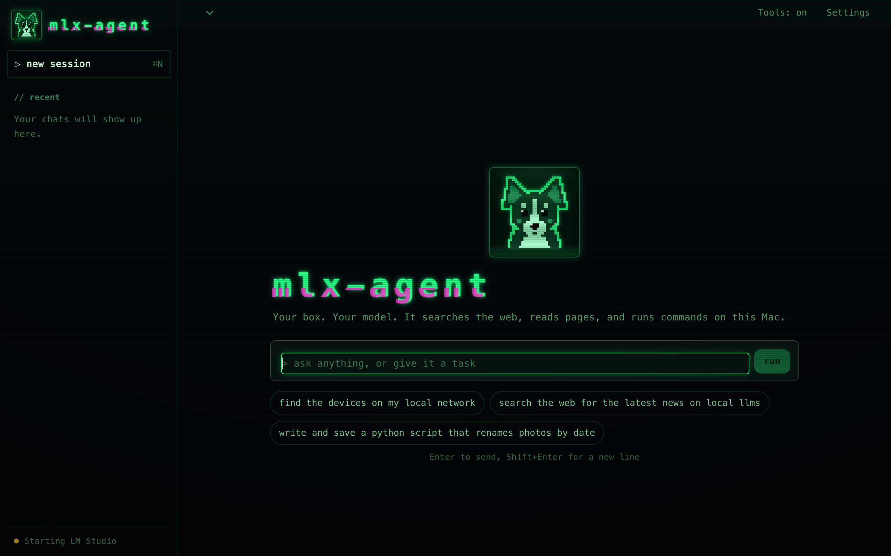
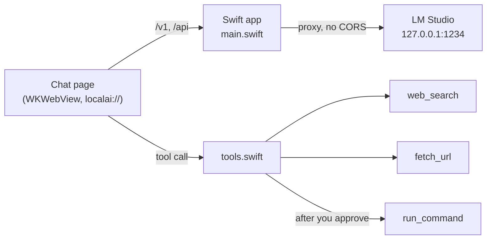

# mlx-agent

An on-device AI agent for Apple Silicon. It runs open models locally through LM Studio (MLX or GGUF), and it can search the web, read pages and run shell commands to finish a task. Nothing leaves your Mac except the searches and pages you ask for.



## What it does

- **Agent loop.** The model calls tools, reads the results and keeps going until the task is done (up to 24 steps). A loop guard stops small models from re-running the same search forever.
- **Three tools, all native Swift:** `web_search` (DuckDuckGo, no API key), `fetch_url` (readable text from any page, Reddit included) and `run_command` (zsh on your Mac).
- **You approve every command.** `run_command` shows the exact command and waits for Approve or Deny. Output is capped at 4,000 characters and commands time out after 5 minutes.
- **Streams thinking separately** for reasoning models, and shows time to first token and tokens per second for each reply.
- **Starts LM Studio's server for you** if it isn't running.

## How it works



The page is served from the app bundle on a custom `localai://` scheme, and the Swift side proxies `/v1` and `/api` to LM Studio, so LM Studio never needs CORS switched on. Tools run natively in Swift, which keeps the page sandboxed and lets cross-origin search and page reads work. Chats are saved to `~/Library/Application Support/mlx-agent/data.json`.

## Build

You need macOS 13+, Xcode command line tools, Node, and [LM Studio](https://lmstudio.ai) with at least one model downloaded.

```bash
./build.sh                 # runs the checks, builds mlx-agent.app, installs it in /Applications
NO_INSTALL=1 ./build.sh    # build only, into ./build
```

`build.sh` runs two checks before it builds: `check.js` (streaming parser, tool-call reassembly) and `tools-check.swift` (the native tools, offline). If either fails, nothing is built.

## Files

| File | What it is |
|---|---|
| `main.swift` | Window, `localai://` scheme handler, LM Studio proxy |
| `tools.swift` | `web_search`, `fetch_url`, `run_command` |
| `index.html` | Chat UI and the agent loop |
| `lib.js` | Pure helpers: SSE parsing, think-tag splitting, tool-call reassembly |
| `pixel-art.swift` | Draws the app icon and the pixel-dog sprite, no image assets |

## License

MIT. Bundles [marked](https://github.com/markedjs/marked) (MIT) for Markdown rendering.
